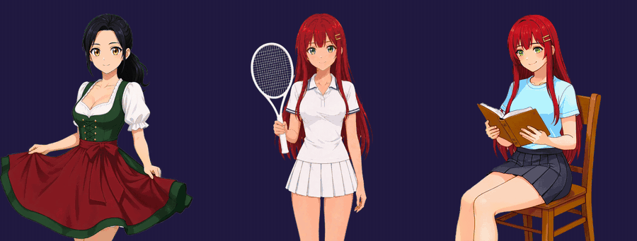
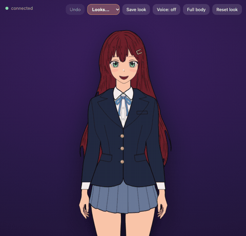
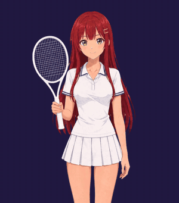
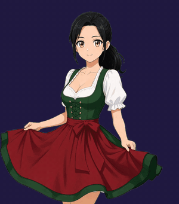
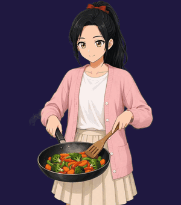
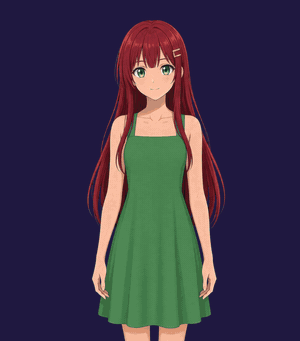
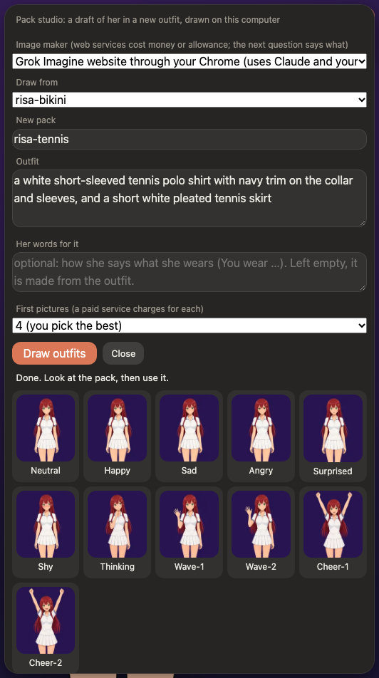

<p align="center">
  <br>
  <sub>Picture packs (pictures made with AI): Franzi dances, Risa plays tennis and splashes water at you.</sub>
</p>

<h1 align="center">Anime AI Companion</h1>

<p align="center">
  <b>A face for your coding agent.</b><br>
  A free, open-source anime character on <b>your own computer</b>, in front of Claude Code, Cursor, opencode or a local Ollama model.<br>
  She asks before every command and answers from your phone. Drawn by code, she redraws herself on request;<br>
  in picture packs she dances and plays tennis. And you can have new outfits made for her.
</p>

<p align="center">
  <a href="https://rhedak.github.io/anime_ai_companion/demo/"><b>▶ Try the demo</b></a> &nbsp;·&nbsp;
  <a href="https://rhedak.github.io/anime_ai_companion/download.html"><b>Download</b></a> &nbsp;·&nbsp;
  <a href="https://rhedak.github.io/anime_ai_companion/">Documentation</a> &nbsp;·&nbsp;
  <a href="https://www.youtube.com/shorts/E_4PIfWC-5U">Trailer</a>
</p>

<p align="center">
  
  
  
  
</p>

The **demo** is a live Risa in your browser: nothing to install and nothing sent anywhere.

## What makes her different

| | |
| --- | --- |
| **She asks first.** | In work mode she reads, edits and runs commands in your project folder, and **every command and file change waits for you**, with the exact text or diff on a card. Looser modes are opt-in and come back to "ask" at every start. A phone on your network can answer the cards. |
| **She can look two ways.** | **Drawn by code** (the default), so she can change her hair, eyes, glasses and clothes the moment you ask, or in **picture packs**: sets of pictures (made with AI) with polished art and activities such as dancing and tennis. [Both below.](#two-ways-she-can-look) |
| **You dress her.** | The **pack studio** draws a whole new picture pack from an outfit you describe, with an image model *you* choose: one on your computer, an API key, or a website you already use. A card says what it costs before anything is drawn. |
| **Your brain, your login.** | It runs on your own computer with the agent you already use. Nothing is hosted, and there is no telemetry. |

## Two ways she can look

| | Drawn by code (the default) | Picture packs |
| --- | --- | --- |
| **What it is** | A vector drawing made by code ([anime-character-creator](https://github.com/rhedak/anime-character-creator)): hair, eyes, glasses, hats and clothes are parameters. | A folder of pictures: the seven expressions with blinks and mouths, poses, and optional activities. Pictures made with AI, bundled, downloaded on request, or made by you. |
| **Strength** | **She can redraw herself in an instant**: "mint green hair", "glasses and a witch hat". Every change is reversible, looks can be saved, and there are many built-in characters. | Polished art, a fixed outfit per pack, and **activities**: dancing, swimming, cooking, reading, tennis. |
| **Limit** | Simpler, less polished. | A pack cannot change its hair or clothes: another outfit is another pack (the studio makes them). |

<table>
  <tr>
    <td valign="top">
      <b>Drawn by code.</b> The picture shows the app's own drawing, answered by its built-in script: no model was needed to change her. Ask for "mint green hair" or "glasses and a witch hat" and she is redrawn on the spot, still blinking and talking.
    </td>
    <td width="330"></td>
  </tr>
</table>

### Picture packs and their activities

An **activity** is something a pack's character does for a while instead of just talking. Ask her to play tennis and her picture turns into a loop where the ball comes at you and she hits it back. These four are picture packs (original characters, made with AI).

<table>
  <tr>
    <td align="center"><br><sub>Risa plays tennis</sub></td>
    <td align="center"><br><sub>Franzi dances</sub></td>
    <td align="center"><br><sub>Risa splashes</sub></td>
    <td align="center"><br><sub>Franzi cooks</sub></td>
  </tr>
</table>

Risa and Franzi are original characters, and their pictures were made with AI (MIT licence, details in each pack). You can make packs like these with the pack studio; the drawn character above is code, not pictures.

## Make her a new outfit

The **pack studio** turns *"a dark green hooded coat over a white knitted sweater"* into a complete picture pack: seven expressions with blinks and talking mouths, waves and cheers, all cut out and ready to wear. Risa's green coat and tennis outfits were drawn this way.

<table>
  <tr>
    <td valign="top">

| Image maker | What it costs you |
| --- | --- |
| **A model on your computer** (a loopback server you run, such as FLUX.2 klein; [how to set it up](https://rhedak.github.io/anime_ai_companion/local-model.html)) | Nothing but time and about 22 GB of memory |
| **An API** (xAI, Google Gemini, OpenAI) with your own key | Paid per picture: counted live, with a limit per pack |
| **A website you are signed in to** (Grok Imagine, Gemini, ChatGPT), driven through Claude in Chrome | No per-picture bill: it uses your Claude allowance and the site's. Slower; free accounts run out |

Every picture is checked and tried up to three times, you look at the whole pack before anything is written, and in chat she can suggest an outfit but **never starts it**. It is off at every start. None of these suits you? `/studio handover` gives you a prompt to copy into any AI agent that makes pictures, with a [guide for agents](https://rhedak.github.io/anime_ai_companion/agent-guide.html). [How the studio works](https://rhedak.github.io/anime_ai_companion/pack-studio.html)

</td>
    <td valign="top" width="300"><br></td>
  </tr>
</table>

## A coding agent you can watch


- **Approvals you can read.** Every command and file change waits for you, with the exact text.
- **Carry on from your phone.** One flag (`--lan`), or `/phone` in the desktop app, lets your phone join the session and answer the cards.
- **A companion too.** Chat mode is a friend with a face: character cards, her own notes about you, an optional microphone.

```
browser ──ws── Node server ──┬─ a brain: Claude Code, Cursor, opencode or Ollama   (the persona and the tools)
                             └─ a worker thread (src/render-worker.ts)             draws her, via anime-character-creator
```

**Made with AI coding agents, mostly Claude Code; the documentation was written by Claude Code:** see [How this was made](#how-this-was-made).

It is free to use, change and share (MIT). Everything runs on your machine; the only thing that leaves it is the
conversation your own brain sends to its provider (nothing at all with Ollama), and, if you turn on the microphone
button, the recording your browser's speech recognition sends to the browser maker. The desktop app can, only if you say yes, ask GitHub once a
day whether a newer version exists (it never installs anything).

## Start in a minute

**Download** the installer for Windows, macOS or Linux from the [Download page](https://rhedak.github.io/anime_ai_companion/download.html) (it also says what your system warns about on the first start, because the app is not signed yet), or **try the [demo](https://rhedak.github.io/anime_ai_companion/demo/)** with nothing installed.

**From source** (Node.js 22.18 or newer, and one brain: Claude Code, Cursor, opencode or Ollama; without one she runs a small built-in script and says so):

```bash
git clone --branch v0.7.2 https://github.com/rhedak/anime-character-creator.git
git clone https://github.com/rhedak/anime_ai_companion.git
cd anime_ai_companion
npm install
npm start          # then open http://127.0.0.1:3737
```

The first line takes the creator release this version was made for (`--branch`; its `main` may be ahead of it). Without a creator checkout next to this one, the app downloads the pinned release itself on the first start. `node bin/anaico.js --doctor` says what is missing. On Windows, `windows-start.bat` ([steps](docs/windows.md)) installs what is missing if you say yes. No Python is needed.

Try: *"Hi! Could you change your hair to mint green and put on a black witch hat?"*

## Read more

The full documentation is on the **[documentation site](https://rhedak.github.io/anime_ai_companion/)**, with pictures and a menu:

- **[Getting started](https://rhedak.github.io/anime_ai_companion/getting-started.html)**: requirements, the `anaico` command, running in the background, every setting, when it does not start
- **[Chatting with her](https://rhedak.github.io/anime_ai_companion/chatting.html)**: moods, scenes, voice, pictures, `!commands`, long conversations and the usage line
- **[Brains](https://rhedak.github.io/anime_ai_companion/brains.html)**: Claude Code, Cursor, opencode and local Ollama models
- **[Work mode](https://rhedak.github.io/anime_ai_companion/work-mode.html)** and **[from your phone](https://rhedak.github.io/anime_ai_companion/phone.html)**: approvals, folders, skills, Chrome
- **[Her looks](https://rhedak.github.io/anime_ai_companion/looks.html)**, **[picture packs](https://rhedak.github.io/anime_ai_companion/picture-packs.html)** and the **[pack studio](https://rhedak.github.io/anime_ai_companion/pack-studio.html)**
- **[Customising](https://rhedak.github.io/anime_ai_companion/customising.html)**: her persona, notes about you, character cards, the interface
- **[Slash commands](https://rhedak.github.io/anime_ai_companion/commands.html)** and **[how it works](https://rhedak.github.io/anime_ai_companion/how-it-works.html)**
- **[Safety and privacy](https://rhedak.github.io/anime_ai_companion/safety.html)**: how the server is locked down, and what leaves your computer

## Safety in short

She asks before every command and file change; looser modes are opt-in and come back to "ask" at every start. The server listens on `127.0.0.1` only, unless you turn on phone access yourself (`--lan`, or the yes to `/phone`), and then a phone has to be allowed on the computer first. The page has a strict Content-Security-Policy, everything the model chooses is validated, and a character card is treated as text from a stranger. Other software on your computer can still reach the port, so run it on a computer only you use. The details are on the [safety page](https://rhedak.github.io/anime_ai_companion/safety.html); found a problem? Please open an issue, or report it privately if it is serious.

## Using it with your Claude account

This project runs **on your own computer, with your own unmodified `claude` and your own login**.
Please keep it that way:

- Do not host it as a service for other people, and do not build anything that collects, stores
  or relays Claude credentials. Anthropic's terms do not allow routing other people's requests
  through a subscription. See the
  [Claude Code legal and compliance page](https://code.claude.com/docs/en/legal-and-compliance).
- Plan limits assume ordinary individual use; a companion who chats all day uses them up faster
  than you might expect.
- Prefer an API key? Claude Code supports `ANTHROPIC_API_KEY`; this project does not change that.
- This is an independent project, **not affiliated with or endorsed by Anthropic**.

## Sharing improvements (a friendly request, never a requirement)

The licence lets you do anything with this code, and that is the point. If you improve it, or fix
something in your checkout of [anime-character-creator](https://github.com/rhedak/anime-character-creator),
a pull request would make it better for everyone, and it is very welcome. Small ones are great.
See [CONTRIBUTING.md](CONTRIBUTING.md). If either checkout has local changes, the server mentions
this once a week at startup (local check only, no network); `COMPANION_NO_NUDGE=1` turns it off.

## How this was made

**This project was built with AI, and you should know that.** The code of this repository and the code of the
[character creator](https://github.com/rhedak/anime-character-creator) behind it were written with AI coding agents,
directed by their owner: mostly **Claude Code** (Anthropic), with some work done with **Cursor** (using Grok models)
and **opencode** (using the free "Big Pickle" model). AI-written code can be wrong. There is an automated test suite
and safety rules written into the code (see [Safety in short](#safety-in-short)), but treat this as you would any
software you have not read line by line.

- **The documentation** (the README and the documentation site) was written by Claude Code,
  from the code.
- **The drawing** is ordinary code: when a character is drawn, no image generator runs. But the characters' designs
  began from AI-generated reference images (some made with Grok, kept in the creator's `ref/` folder), which set the
  style and the first roster, and several characters, Katherina and Risa among them, were traced from such
  references.
- **The Hatsune Miku pictures, the Risa (dress) pictures and the Draconia pictures** were made with Grok Imagine (see [Credits](#credits)).
- **The commits** made by Claude Code in this repository carry a `Co-Authored-By` trailer. The creator's commits do
  not, so its history does not show which were AI-written: assume most of its code was.

## Credits

- Characters are drawn by **[anime-character-creator](https://github.com/rhedak/anime-character-creator)**
  (MIT), a program that draws them from parametric shapes in code, not by hand and not by image generation
  (the code is AI-written and the designs began from AI-generated references: see
  [How this was made](#how-this-was-made)). Please keep saying so if you share what it makes.
- [`ws`](https://github.com/websockets/ws) for WebSockets.
- `packs/risa-dress`: an original character, pictures made with Grok Imagine (AI-made; MIT, see its `NOTICE.md`).
- The Hatsune Miku pack (downloaded on request from the [packs repository](https://github.com/rhedak/anime_ai_companion-packs), not part of this repository): Hatsune Miku © Crypton Future Media, INC. (www.piapro.net), unofficial fan art under the
  [Piapro Character License](https://piapro.net/license/pcl). Not MIT; see its `NOTICE.md`.
- The Draconia Malfoid packs (downloaded on request from the [packs repository](https://github.com/rhedak/anime_ai_companion-packs), not part of this repository): unofficial fan art, non-commercial, not affiliated with or endorsed by Warner Bros. or Wizarding World. Not MIT; see each pack's `NOTICE.md`. They will be taken down on request (rhedak00@yahoo.de).

## Code of conduct

See [CODE_OF_CONDUCT.md](CODE_OF_CONDUCT.md) (the Contributor Covenant).

## Licence

[MIT](LICENSE). Everything in this repository is MIT. The exceptions are two packs you can download, not part of this repository: the Hatsune Miku pictures
(see above) show a character that belongs to Crypton Future Media and may only be used non-commercially, under the terms in the pack's own `NOTICE.md`; the Draconia Malfoid pictures are unofficial fan art under the same kind of exception (non-commercial, taken down on request; see the pack's `NOTICE.md`).
