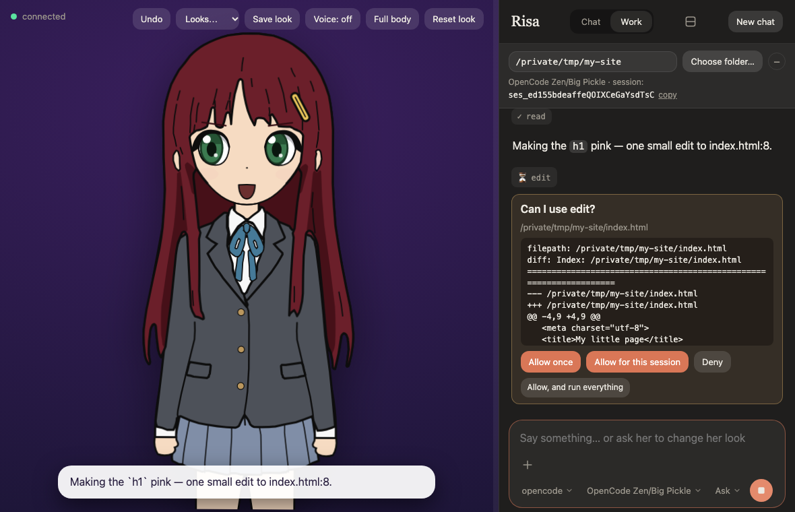

# Anime AI Companion

**A face for your coding agent.** A local, browser-based anime character, drawn by code, that sits in front of
**Claude Code, Cursor, opencode or a local Ollama model**. She chats, her expression follows the conversation, and in
**work mode** she reads, edits and runs commands in your project folder, asking first with a card that shows the exact
command or diff. A phone on your network can answer those cards. Ask her to redesign herself ("blue hair and
glasses, please") and she redraws.



[Watch the short trailer](https://www.youtube.com/shorts/E_4PIfWC-5U) (about half a minute).

- **Approvals you can read.** Every command and file change waits for you, with the exact text. Looser modes are opt-in
  and come back to "ask" at every start.
- **Your brain, your login.** It runs on your own computer with the agent you already use. Nothing is hosted, and
  there is no telemetry.
- **Carry on from your phone.** One flag (`--lan`) lets your phone join the session and answer the cards.
- **A companion too.** Chat mode is a friend with a face: character cards, her own notes about you, an optional
  microphone, picture packs instead of the drawn character.

```
browser ──ws── Node server ──┬─ a brain: Claude Code, Cursor, opencode or Ollama   (the persona and the tools)
                             └─ python render_worker.py                            draws her, via anime-character-creator
```

**Documentation: <https://rhedak.github.io/anime_ai_companion/>** (the same material as below, with pictures and a menu).
**Made with AI coding agents, mostly Claude Code; the documentation was written by Claude Code:** see [How this was made](#how-this-was-made).

It is free to use, change and share (MIT). Everything runs on your machine; the only thing that leaves it is the
conversation your own brain sends to its provider (nothing at all with Ollama), and, if you turn on the microphone
button, the recording your browser's speech recognition sends to the browser maker.

## Requirements

- **Node.js 22.18 or newer** (it runs the TypeScript directly, no build step)
- **Python 3.11 or newer** (the character renderer is pure standard-library Python). If your `python3`
  is older, `uv sync` makes a `.venv` with a suitable one, and the app uses it automatically
- **One brain**, installed and signed in: [Claude Code](https://code.claude.com) (`claude`), Cursor (`cursor-agent`), opencode,
  or [Ollama](https://ollama.com) for a local model
- A checkout of **[anime-character-creator](https://github.com/rhedak/anime-character-creator)**
  next to this repo, or point `CREATOR_SRC` at its `src` folder

## Quick start

```bash
git clone https://github.com/rhedak/anime-character-creator.git
git clone https://github.com/rhedak/anime_ai_companion.git
cd anime_ai_companion
npm install
uv sync           # only if your python3 is older than 3.11: creates .venv, which the app then uses
node bin/anaico.js --doctor   # optional: says what is missing (Node, Python, a brain, the creator, the port)
npm start          # then open http://127.0.0.1:3737
```

Try: *"Hi! Could you change your hair to mint green and put on a black witch hat?"*

## Configuration

| Env var | Default | |
| --- | --- | --- |
| `COMPANION_MODEL` | `haiku` | model used for chat |
| `COMPANION_WORK_MODEL` | `sonnet` | model used in work mode |
| `COMPANION_PROVIDER` | `claude` | `claude` (Claude Code), `cursor` (Cursor agent), `opencode` or `ollama` (local models); also switchable in the UI |
| `COMPANION_OPENCODE_MODEL` | opencode's own default | model for opencode, `provider/model` (e.g. `opencode/big-pickle`) |
| `PYTHON` | `.venv` if present, else `python3` | the Python that runs the renderer |
| `OLLAMA_HOST` | `http://127.0.0.1:11434` | where Ollama is listening |
| `COMPANION_OLLAMA_TOOLS` | unset | model names (comma separated) or `all` that you vouch can use tools, when your Ollama cannot report it |
| `COMPANION_OLLAMA_CTX` | `16384` | context size asked of Ollama in work mode with tools |
| `OLLAMA_MODEL` | first installed | model to use with Ollama |
| `COMPANION_PRESET` | `risa` | starting character (any preset of the creator) |
| `CREATOR_SRC` | `../anime-character-creator/src` | where the creator package lives |
| `PORT` | `3737` | |
| `COMPANION_NO_SHELL` | unset | set to `1` to turn off the `!command` box (see Security model) |
| `COMPANION_NO_NUDGE` | unset | set to `1` to silence the friendly reminder below |

## Voice

The **Voice** button makes her read her replies aloud with your browser's own speech synthesis. She speaks
sentence by sentence while the reply streams, and her mouth moves while she speaks. With Voice on, two menus
choose the **voice** and the **speed**; both are remembered in the browser. System voices are made on your device and
nothing is uploaded; a voice marked **online** (desktop Chrome's "Google …" voices) is made by a server, which
receives the text. **Speaking to her** is an opt-in: a microphone button next to the attach button
(where the browser has speech recognition) asks first, because in Chrome, Edge and Safari your recording is sent to the browser
maker's servers to be turned into text. This app's server never receives audio. It listens for one phrase while the button
is lit, and puts the words in the message box for you to check; nothing is sent by itself. Microphones need `localhost` or
HTTPS, so on a phone over plain `http` use the keyboard's microphone key. To change the voice itself (pitch, a voice per
character, a local TTS engine), edit `public/speech.js` in your own checkout; the
[customising page](https://rhedak.github.io/anime_ai_companion/customising.html#her-voice) has ideas.

## Looks: undo, save, load

She can redesign herself at any time, so it is reversible: **Undo** steps back through her recent
changes, **Save look** stores the current look by name, and the **Looks** menu loads one, or opens **Presets…**, a gallery with a preview of each of the 19 built-in characters (Undo brings the old look back). She can load
a saved look herself too (`[avatar load=name]`). Saved looks are plain files in `data/looks/`; delete a
file to delete a look.

## Your own pictures instead of the drawn avatar

If you would rather show her as pictures from an AI image tool (or your own drawings), put a set of images
in `data/frames/<name>/` and pick it from **Looks → Packs…** (or type `/frames <name>`): a rest picture, a blink, a few mouth openings, and one set
per emotion if you like. Only `neutral.png` is required. Choosing the drawn avatar in that gallery (or `/frames off`) goes back, and so does
picking one of your saved looks or a preset.
`docs/frame-packs.md` has the file names, a sample pack drawn by the creator (`python/make_sample_pack.py`),
and how to get a consistent set out of an image tool.

A **Hatsune Miku** pack comes with the app: Looks → Packs… → Miku (or `/frames miku`). She is Crypton's character, so that pack is
unofficial fan art for **non-commercial** use under the Piapro Character License, with its credit shown on
screen and its terms said in the chat when you choose it. Read [`packs/miku/NOTICE.md`](packs/miku/NOTICE.md) before you use or share it, and follow its terms
yourself: this project cannot grant you the right to use the character.

## Local models with Ollama

Pick **Ollama (local)** under *Brain* and she is powered by a model on your own machine: nothing
leaves it at all. Install [Ollama](https://ollama.com), `ollama pull llama3.2` (or any chat model),
and choose the model in the dropdown. The same persona and the same `[emotion:...]` / `[avatar ...]`
tags drive the avatar, though small models follow the tag protocol less reliably. Chat never uses tools.
Switching brains starts a fresh conversation.

**Work mode with a local model is experimental, and the quality is your responsibility.** If Ollama reports that the
model supports tool calls (a recent Qwen or Llama, for example; `ollama show <model>` lists its capabilities), the **Work** button
works with it. She can then read files, search, run a command, create a file and edit one in your project folder. How well a local model
uses tools depends entirely on the model and its size: small or older ones call tools badly (wrong arguments, loops, or text
that only looks like a tool call), and any model can propose a wrong or harmful command or edit with full confidence. Every
command, file write and edit waits for your approval and shows exactly what it will do, so reading the card is your job;
there is no mode that skips it for Ollama (only **Ask** and **Plan**, and Plan offers reading and searching only). Reading and
searching inside the project are pre-approved, like for the other brains. Nothing outside the project folder can be read or
written through her tools, but an approved `bash` command can do anything your user can. The app does not test, rate or vouch
for any local model: work done through one is at your own risk, so keep the project under git and check the result. She stops
after 12 tool steps in a row. Ollama's default context window is small, so tool work asks for 16384 tokens (change it with
`COMPANION_OLLAMA_CTX`); a big model with a big window needs the memory for it. If your Ollama is too old to report capabilities
and the model is not a known family, vouch for it with `COMPANION_OLLAMA_TOOLS=<model name>` (or `all`).

## Cursor

Pick **Cursor** under *Brain* and she is driven by `cursor-agent` on your machine (Composer, Grok, or
any other model that agent lists). Sign in once with `cursor-agent login`, or set `CURSOR_API_KEY`.
The conversation still goes to Cursor; files stay on this machine. Chat mode is read-only. Work mode
asks with the same approval card as Claude, and the Permissions menu adds **Run everything**
(`cursor-agent --force`): tools run without a card, a deny rule still blocks, and the choice resets
to Ask every time the server starts. Auto and Accept edits stay Claude Code modes.

## opencode

Pick **opencode** under *Brain* and she is driven by `opencode acp` on your machine, signed into
whatever models your opencode install already knows (choose one in the dropdown, or leave it on
opencode's default). Sign in once with `opencode auth login`. The conversation goes through
opencode; files stay on this machine. Chat mode is read-only. Work mode asks with the same approval
card as Claude; the menu offers **Ask**, **Plan** and **Run everything** (an opt-in that lets every
tool run without a card, and resets to Ask every server start). Every start runs isolated: your
project's own `opencode.json`, plugins and MCP servers stay unloaded, and approvals reset to Ask.

## Work mode

Flip the **Work** switch, pick a project folder, and she can read and edit files and run commands
there, like a regular Claude Code session. She asks first:

- Every action that is not pre-approved shows an approval card with the **exact** command or file
  content. Choose *Allow once*, *Allow for this session*, or *Deny*; a denial is not retried.
- The **Permissions** menu changes how approvals work: *Ask for each action* (the default),
  *Plan first* (she reads and proposes a plan; nothing changes until you approve it), *Accept edits*
  (file edits no longer ask; commands still do), and *Auto* (Claude Code's own classifier approves
  routine actions and blocks risky ones, so fewer cards reach you). With Cursor, the menu is Ask,
  Plan and **Run everything** instead of Accept edits and Auto. It resets to *Ask* on every start
  and can be changed at any time, even while an approval card is waiting; the conversation carries on.
  Approval cards also offer *Allow, and accept all edits* (for file edits) and *Allow, and switch to
  Auto*, like the terminal's "yes, and don't ask again".
- Pre-approved without asking: `Read`, `Grep`, `Glob` (edit in `data/settings.json`).
- **Work here** applies the folder typed in the box. Once she already works in that folder, the same button
  reads **Choose folder…** and opens your system's folder dialog (macOS, or Linux with `zenity` or
  `kdialog`; elsewhere type the path), starting in the current folder; picking one switches to it.
  Enter in the box always means "use what I typed".
- The folder settings above the chat fold away with the **−** button into a one-line summary (**+** or a click
  on it opens them again), for more room; the choice is remembered in the browser.
- By default your own Claude Code setup is **not** loaded: a folder's `.claude/settings*.json` hooks
  and allow rules, your user settings and MCP servers do not apply, so opening an unfamiliar folder
  runs nothing of its own. The **Use my Claude Code setup** checkbox (or `/setup on`) loads them, as
  in a terminal; hooks run commands, so it is off at every start. The home directory or `/` cannot be
  chosen as a folder.
- **Skills.** Skills are not loaded by default either, so she cannot call one by name and would have to read its file by hand. The **Use my skills** checkbox, or `/skills on`, lets her use your own skills (`~/.claude/skills`) by name. It loads your user settings but keeps hooks off, and a folder's own skills stay off: those only load with the whole setup above. It is off at every start. When she reaches for one of your skills while they are off, she asks first, and a folder with its own skills says so once.
- With Claude Code, helpers (subagents) can keep running after her reply ends: a line above the message box says
  **Waiting for N background agents to finish…** (hover for what each is doing), and a reply she gives when one finishes
  appears in the chat like any other.
- Work mode uses a stronger model (`COMPANION_WORK_MODEL`, default `sonnet`) and counts against your
  plan limits faster than chatting.
- The bar under the header shows `claude --resume <session id>`: you can continue the same
  conversation in a terminal. Only one side should write at a time.

`anaico` starts in work mode for the folder you ran it from (a home directory or `/` falls back to
chat). `anaico --chat` starts in chat mode instead; the folder is still pre-filled, so the **Work**
switch is one click. A server started another way (`npm start`) begins in work mode only if it has a
saved folder, and in chat mode otherwise. A server that is already running keeps its mode and folder.

### Running it in the background

`anaico --daemon` starts the server in the background and returns; it keeps running after you close the
terminal (its output goes to `data/server.log`). Take the same `--chat` and `--no-open` as usual.

A problem in the page itself (a script error, an animation frame that failed) shows as an orange ⚠ line in the chat; tap it
for the details. It is also written to the server's log as `[page ...]`, so a problem on your phone can be read on the computer.
`anaico --doctor` checks what the companion needs (Node, Python, a brain, the character creator, the port) and says what is
missing and how to fix it; it only looks and changes nothing. `anaico --status` says whether it is running, `anaico --stop` stops it, and `anaico --restart` stops and
starts it again in the folder you run it from (use it after an update, or to change folder or mode).
Only a server started with `--daemon` is managed this way: `--stop` and `--restart` will not touch one
that is running in another terminal. Unless you start it with `--lan` (next section), the server only
listens on `127.0.0.1`, and a background server is no different.

## Controlling her from your phone

`anaico --lan` (or `npm start -- --lan`) also lets other devices on your network in, so you can carry on
a session from your phone while the computer does the work. It is **off at every start**: you ask for it
each time, like a looser permission mode.

1. Start with `--lan`. It prints a few links ending in `?t=<token>`, one per way the phone can reach this
   computer (the Wi-Fi address first, then other addresses such as Tailscale, then its `.local` name). Type
   `/phone` in the chat to see them again, with a **QR code** for the first one: scan it with the phone's camera.
2. Open the link on the phone, on the same Wi-Fi. The first visit signs the phone in (a cookie) and removes the
   token from the address, so the page stays open without it.
3. `/phone new` makes a new token and signs every phone out.

What a phone can do: chat, answer the approval cards, stop her, switch between chat and work in the saved
folder, change the look. What it cannot, because these run without a card or reach into the computer: `!commands`,
the loose permission modes (Auto, Accept edits, Run everything), `/setup on`, `/skills on`, importing or resetting a
character card, opening her notes file, picking another project folder. Those are done on the computer itself.

On a narrow screen she is above the chat, with a bar between them to drag up or down (double-tap resets it). The
button in the chat's header puts her behind the chat instead: the chat takes the whole screen and she shows
faintly through it; dragging the bar on past the smallest she gets does the same. That works on a wide screen too,
and the choice is remembered in that browser.

The token is a password, and the connection is plain `http`, so use it only on a network you trust (not
café Wi-Fi), and not through a tunnel you do not control. For use away from home, put the computer and the phone
on a private network such as Tailscale and use the computer's address there; `--lan` lists it among the links.
The token is saved in `data/lan-token` (only you can read it). On the phone's plain-`http` page the browser
withholds the clipboard, so the copy buttons do nothing there. If the page does not load at all
(`ERR_ADDRESS_UNREACHABLE`), the network is in the way, not the app: turn off a VPN on the phone, and look for
"client isolation" or "AP isolation" in the router's Wi-Fi settings, which lets Wi-Fi devices reach the router
but not each other. macOS asks once whether `node` may accept
incoming connections: allow it.

## Her name

Click her name at the top (or use `/rename Hana`) to rename her: Enter saves, Esc cancels. The name is
saved in `data/settings.json`, shown in the page title and exports, used in her system prompt
(`persona.md` has a `{{name}}` placeholder), and she is told about the change right away. Names are 1 to 24
letters, numbers, spaces and `. ' - _`, so a name cannot carry instructions into her prompt.

## Her notes about you

She can keep a few notes about you across conversations, in `data/memory.md`: one short fact per line, plain Markdown you can
open and edit.

- In chat, when you tell her something worth keeping (your name, a preference, something you ask her to remember), she
  adds it herself, and the chat shows each one (**🧠 Remembered: …**). Up to 50 notes, 200 characters each.
- `/memory` lists them, `/memory add <note>` adds one, `/memory forget <number>` (or `all`) removes one, and `/memory edit`
  opens the file. An edit by hand is picked up with her next message.
- She is told her notes with the first message of a conversation, and only what changed after that, so the prompt that
  Claude keeps cached is never touched. A new conversation (`/clear`) gets the full list again.
- Notes are information about you, not instructions: they are handed over as data. **She saves nothing in work mode**, because a
  file or web page she reads there could talk her into writing a note that outlives the conversation; use `/memory add` there.
- The file belongs to you: it stays in `data/`, out of git, and nothing is sent anywhere except in her messages to your brain.
  Switching brain starts a new conversation, so she is told the notes again.

## Character cards

Character cards (the community format used by [SillyTavern](https://github.com/SillyTavern/SillyTavern), [Chub](https://chub.ai) and similar sites: a `.json` file, or a `.png`
with the card inside) can give her a ready-made personality.

- `/card import <file>` reads a V1, V2 or V3 card and shows what it will add. Nothing changes until you choose
  **Use this card** (or `/card apply`); **Cancel** (or `/card cancel`) drops it.
- Her description, personality, scenario, example lines and name are always used. HTML and our own tags
  (`[emotion:…]`, `[avatar …]`, `[image …]`) are removed from the text, `{{char}}` becomes her name, and each field is capped
  in length. The author's own notes are shown in the preview, nothing more.
- A card can carry more, and the preview offers each part as a checkbox:
  - **Her greeting** (`first_mes` and the alternate greetings): new conversations open with it, shown by the page without
    asking the model, so it costs nothing. She is told afterwards what she said. Ticked by default.
  - **The lorebook:** short background entries that are added to your message when it mentions their keywords, each entry once
    per conversation, at most three entries and 1,500 characters per message (it adds to what a message costs). Only plain
    keywords are supported, not regular-expression keys. Ticked by default.
  - **The card author's own instructions** (`system_prompt` and `post_history_instructions`): off by default. These are
    orders written by the card's author, and they apply in chat **and in work mode**, where she can read files and run
    commands. They sit before her style notes and the expression protocol, and the protocol still applies, but a card can
    tell her to behave in ways you do not expect, ignore your project's rules, or (if it is malicious) steer her toward harmful
    commands. Every command still waits for your approval, but you are trusting the card's author. The preview warns strongly
    once and that is the only warning: using them is entirely your own risk.
  - Not supported: a card's `extensions` (front-end scripts and the like).
- Her name becomes the card's name if it fits the name rules. Her look is not part of a card.
- The card is saved in `data/character.json` and replaces only the first part of `persona.md`. The style notes and the
  expression protocol stay. A conversation that is already running keeps the persona it began with, so use `/clear`.
- `/card apply greeting lore orders` (any of the three words) applies a waiting card with exactly those parts; plain `/card apply` uses the greeting and lorebook.
- `/card export` downloads her current character as a V2 card, with the greeting, instructions and lorebook if a card brought them. `/card reset` goes back to `persona.md` (she keeps the
  name; rename her with `/rename`).
- A card is text written by someone else and it becomes part of her instructions. Read the preview before you accept it.
  Importing and resetting work from the computer itself only, not from a phone.

## Changing how it looks

All colours, fonts, corner radii and sizes of the interface are CSS variables at the top of
[`public/theme.css`](public/theme.css), with a comment on each. `public/style.css` only uses them.
To restyle it, put your changes in **`data/custom.css`** (create it; it is yours, git ignores it, updates
never overwrite it, and deleting it restores the default look). It loads last and a page reload shows
the change, so you can simply ask an AI assistant: "edit `data/custom.css` to make the chat panel light
with a blue accent and rounded corners; the variables are documented in `public/theme.css`".

```css
:root { --accent: #4f9d69; --surface: #22302a; --panel: #17201c; --radius-lg: 6px; --font-heading: "Courier New", monospace; }
```

Anything the variables do not cover can be restyled with ordinary CSS rules in the same file. Risa's own
appearance (hair, clothes, face) is separate: ask her to change it in chat.

## How her replies are shown

Her replies render a small, safe Markdown subset: paragraphs, headings, **bold**, *italic*, `code`,
code blocks, lists, quotes and http(s) links. It is built from plain DOM nodes, never HTML, so
nothing she writes can inject markup. `/copy` and `/export` keep the Markdown source. The speech bubble
over her head and spoken replies stay plain text.

## Automatic compaction, and long conversations

Claude Code compacts the conversation by itself when the context gets big, also behind this browser; she
keeps a summary and a note appears in the chat ("compacted automatically, about 106k → 19k tokens"). The
app asks for that at **200k tokens** (`--autocompact 200000`), not near the model's whole 1M window: a
conversation that grows to several hundred thousand tokens makes every later message expensive. To change
it, start the server with `COMPANION_AUTOCOMPACT=300000` (100000 to 1000000, or `auto` for Claude Code's own
choice). `/compact` does it on demand, and the `ctx` figure in the usage line shows how close you are.

Claude keeps the conversation in a prompt cache, so each message normally only pays for what is new. The
cache lives about an hour. If you come back after that to a conversation of 100k tokens or more (or
`/resume` an old one), the next message would have to send all of it again at full price, which can use a
big share of your usage limit. So that message waits, and a card asks:

- **Summarise, then send**: runs `/compact` first (like "resume from summary" in the terminal), then sends
  your message. Reading the conversation once to summarise costs about what sending it would, but every
  message after that is cheap. The summary loses some detail.
- **Send as it is**: pays the full read once, keeps every detail.
- **Don't send**: your text goes back into the message box.

Restarting the app does not lose the cache by itself: Claude Code stores the system prompt with the
conversation and reuses it on resume. That is also why a change made after the conversation began (a new
look from the menu, a rename, switching to work mode) reaches her as a short note in your next message,
not as a new system prompt.

## The usage line

Under the message box a small line shows the model and its effort, e.g. `Sonnet 5.5 (high)`, your Claude **session** (five-hour) and **week**
usage with their reset times, and **ctx**, how full her memory of this conversation is (`/compact` frees
it up). Numbers turn amber above 80% and red above 95%. The limits come from Claude Code after each
reply, so they are shown dimmed when they are over ten minutes old, and only for a Claude subscription;
with Ollama only the model is shown. Colours are theme variables (`--warn-text`, `--error-text`).

## Effort

The **Effort** menu (or `/effort low|medium|high|xhigh|max|default`) sets how hard Claude thinks; more
is slower and uses more of your limits. Her sessions do not load your Claude Code settings (so a
folder's hooks and rules never run), with one exception: for *Default* the effort level in your own
`~/.claude/settings.json` (`effortLevel` and `modelSettings`) is read, so she thinks as hard as your
terminal does, and the footer shows it. Changing it restarts her process and the conversation carries on.

## Images

The **📎** button next to the message box attaches up to 5 pictures (PNG, JPEG, GIF or WebP, up to 5 MB
each); you can also paste an image or drop files onto the chat. The browser shrinks anything bigger
than 1568 px on its long edge first (a resized GIF or WebP loses its animation), and the server checks
the type, the real file contents and the sizes again. Pictures go to the model as they are and a picture
without text works too. Only a count is kept in the saved chat log, so after a reload the thumbnails give
way to "🖼 2 images". With Ollama they need
a vision model (e.g. `llava`), and only the message that carries them sees them.

## Shell commands with `!`

In work mode, a message that starts with `!` runs in your project folder straight away, like Claude
Code's bash mode: `!ls`, `!git status`. The output appears in the chat (with the exit code if it
failed) and is passed to her with your next message, so she knows what you saw. There is no approval card,
because you typed the command yourself, so the composer turns amber with a reminder while the line starts
with `!`. Commands run in your shell without a terminal and without input, so they cannot ask questions
or open editors; they stop after 2 minutes and their output is cut at 100 KB. Chat mode refuses them.

## Pictures in the chat

When she makes or finds an image in your project folder (a screenshot, a chart, a logo), she can show it
with an `[image path/to/file.png]` tag in her reply: small thumbnails appear under her message, and
clicking one opens a viewer (arrow keys or the side buttons to move between several, Esc to close).
Your own attached pictures open in the same viewer. Only real PNG, JPEG, GIF and WebP files up to
10 MB inside the project folder are shown (at most 8 per reply; she is told if she named more), symlinks that lead out of it are refused, and she is told when
a path did not work. The chat log keeps only the file's location, not a copy, so a picture that has been
deleted or moved later no longer loads after a reload.

## Typing while she answers

You can keep typing while she is still answering: **Enter** queues the message, like in Claude Code. Queued
messages are listed above the box (the **×** takes one back out) and go out one by one as each reply ends, up to ten.
Stop, an error, `/clear` or switching brain does not send them: the text comes back into the box instead (attached
pictures do not, so attach them again). Slash commands and `!commands` are not queued; they run or say to wait. The
queue is not saved over a server restart.

## Stopping her

**Ctrl+C** (or the round stop button that replaces Send while she works) stops her reply, or a running
`!command` (with everything it started). What she had said so far stays in the conversation, and she
carries on with your next message. With text selected, Ctrl+C still copies. On a Mac use the Control key,
not Cmd.

## Slash commands

Type these in the chat box (`/help` lists them):

| Command | |
| --- | --- |
| `/compact [focus]` | summarise the conversation to free up context; she keeps the gist |
| `/clear`, `/new` | start a fresh conversation, like **New chat** |
| `/resume [number]` | list earlier conversations in the current folder (newest first), or continue one; with Claude the chat log is rebuilt from Claude Code's session file, with Cursor she remembers it and the screen starts clean |
| `/cost` | what the conversation has used: an API-price estimate and how full the context is |
| `/model [name]` | show or set the model for the current mode (`/model opus`), until the server restarts |
| `/chat`, `/work [folder]` | switch modes |
| `/permissions [ask\|plan\|accept\|auto\|everything]`, `/plan` | the Permissions menu, from the keyboard; `everything` is Cursor's Run everything |
| `/rc`, `/remote-control` | not built in: explains why and prints the terminal command to use it yourself |
| `/rewind` | not available in the companion: prints the terminal command to continue there and rewind |
| `/effort [level]` | show or set how hard she thinks (restarts her process; the conversation continues) |
| `/setup [on\|off]` | work mode: load your own Claude Code settings, hooks and MCP servers (off at every start) |
| `/memory [add <note> \| forget <number\|all> \| edit]` | her notes about you (`data/memory.md`); she adds notes herself in chat, never in work mode |
| `/card import <file>` \| `apply` \| `cancel` \| `export` \| `reset` | character cards: use a card's personality, or export hers (`/card import` shows a preview first) |
| `/skills [on\|off]` | work mode: let her use your own skills by name; your user settings apply, hooks stay off (off at every start) |
| `/frames [name\|off]` | show her with the pictures in `data/frames/<name>` instead of the drawn avatar; alone, lists the packs |
| `/show` | she shows all her emotions, a blink, talking and her gestures, a second each, naming every one (no model call); asking her "show me all your animations" does the same |
| `/status` | brain, model, mode, folder and session id |
| `/copy` | copy her last reply to the clipboard |
| `/export` | download the conversation as a Markdown file |
| `/voice` | turn spoken replies on or off |

`/resume` looks in the folder she is working in (the project folder in work mode, her own `workspace/`
in chat mode), so it also finds sessions you started in a terminal there; switch modes first to look
elsewhere. It is refused mid-reply and with Ollama.

Anything else that looks like `/word` is reported as unknown instead of being sent to her; paths like
`/etc/hosts` are sent as usual. Commands that change settings are refused mid-reply. Commands that
need Claude Code (`/compact`, `/cost`, `/resume`, `/work`, `/permissions`, `/plan`, `/rc`, `/rewind`) say
so plainly when another brain, such as Ollama, is active, instead of pretending to work.


## How it works

- **Gestures:** `[gesture:wave]` and `[gesture:cheer]` raise an arm for a moment (two pose frames).
- **Showing off:** `[demo]` at the end of a reply starts the same sequence as `/show`. The page plays it, because tags in a
  streaming reply would all fire at once; any new message ends it. A picture pack shows what its pictures have.
- **Emotions:** she starts replies with tags like `[emotion:happy]`; `emotions.json` maps each to
  face settings. The server renders a few mouth openings and a blink per emotion and the browser
  flips between them while text streams.
- **Looks:** she writes `[avatar hair_color=#ff88cc outfit.hat_color=#222 glasses=true]`.
  `python/render_worker.py` validates every key; rejected ones are reported back to her on her next
  turn. Your current look is saved in `data/avatar.json` (git-ignored).
- **Providers:** `src/providers/types.ts` is the interface and Claude Code is the first
  implementation. The tags are plain text, so other backends (for example Ollama) can reuse them.
- The server listens on `127.0.0.1` only, unless you pass `--lan`, and rejects WebSocket connections from other origins.

The roadmap is in [docs/plan.md](docs/plan.md).

## Using it with your Claude account

This project runs **on your own computer, with your own unmodified `claude` and your own login**.
Please keep it that way:

- Do not host it as a service for other people, and do not build anything that collects, stores
  or relays Claude credentials. Anthropic's terms do not allow routing other people's requests
  through a subscription. See the
  [Claude Code legal and compliance page](https://code.claude.com/docs/en/legal-and-compliance).
- Plan limits assume ordinary individual use; a companion who chats all day uses them up faster
  than you might expect.
- Prefer an API key? Claude Code supports `ANTHROPIC_API_KEY`; this project does not change that.
- This is an independent project, **not affiliated with or endorsed by Anthropic**.

## Sharing improvements (a friendly request, never a requirement)

The licence lets you do anything with this code, and that is the point. If you improve it, or fix
something in your checkout of [anime-character-creator](https://github.com/rhedak/anime-character-creator),
a pull request would make it better for everyone, and it is very welcome. Small ones are great.
See [CONTRIBUTING.md](CONTRIBUTING.md). If either checkout has local changes, the server mentions
this once a week at startup (local check only, no network); `COMPANION_NO_NUDGE=1` turns it off.

## Security model

Because the server can run Claude Code, it is built to be reachable only by you:

- It listens on `127.0.0.1` and accepts WebSocket connections only from its own origin. That stops any website you visit
  from talking to it. It does not stop other software on the same computer: a local program can send any `Origin`
  header, and on a shared computer another user could reach the port. Run it on a computer only you use. If you cannot,
  set `COMPANION_NO_SHELL=1` (turns off `!command`, the one way to run a command without a card) and do not use work
  mode: anyone who can reach the port can also answer the approval cards.
- `--lan` is the one way past that, and it is opt-in at every start. Then every page, file and WebSocket
  from another device needs the secret token (a cookie, checked in constant time), a `Host` that is a local
  address or `.local` name (against DNS rebinding), and, for the WebSocket, an `Origin` equal to that address.
  Such a device can still not run `!commands`, loosen the permission mode, load your Claude Code setup or your skills, or change her character.
  Connections from the computer itself are unchanged, so a tunnel or reverse proxy on it is not given a way in.
- The page ships a strict Content-Security-Policy (no inline or foreign scripts, no framing, so nobody can
  click the approval buttons for you).
- Everything the model chooses is validated: avatar values are coerced per field (hex colours, numbers,
  plain-text only for free text), even though the character renderer now escapes text itself (older
  checkouts of it did not). The SVG is also sanitised in the browser before it is shown.
- Work mode never skips permissions (even *Auto* leaves risky actions to Claude Code's safety checks), shows the exact command or content you approve, and does not load a
  folder's own hooks or settings. With Ollama (experimental) every command, file write and edit asks first, there is no looser mode,
  and how well a local model behaves is up to the model and to you.
- Character cards are text from a stranger: cleaned, previewed and confirmed before they apply, with her greeting, the lorebook and the
  card author's own instructions as separate choices (the instructions off by default, with one strong warning at import). The
  expression protocol is never replaced by a card.
- Her notes about you (`data/memory.md`) are saved by her in chat only, never in work mode, and reach her as information, not instructions.
- The one place audio leaves the machine is the opt-in microphone button (the browser's speech recognition); it asks first and the app's own server never receives audio.

Found something? Please open an issue, or report it privately if it is serious.

## How this was made

**This project was built with AI, and you should know that.** The code of this repository and the code of the
[character creator](https://github.com/rhedak/anime-character-creator) behind it were written with AI coding agents,
directed by their owner: mostly **Claude Code** (Anthropic), with some work done with **Cursor** (using Grok models)
and **opencode** (using the free "Big Pickle" model). AI-written code can be wrong. There is an automated test suite
and safety rules written into the code (see the Security model section above), but treat this as you would any
software you have not read line by line.

- **The documentation** (the README and the documentation site) was written by Claude Code,
  from the code.
- **The drawing** is ordinary code: when a character is drawn, no image generator runs. But the characters' designs
  began from AI-generated reference images (some made with Grok, kept in the creator's `ref/` folder), which set the
  style and the first roster, and several characters, Katherina and Risa among them, were traced from such
  references.
- **The Hatsune Miku pictures** were made with Grok Imagine (see [Credits](#credits)).
- **The commits** made by Claude Code in this repository carry a `Co-Authored-By` trailer. The creator's commits do
  not, so its history does not show which were AI-written: assume most of its code was.

## Credits

- Characters are drawn by **[anime-character-creator](https://github.com/rhedak/anime-character-creator)**
  (MIT), a program that draws them from parametric shapes in code, not by hand and not by image generation
  (the code is AI-written and the designs began from AI-generated references: see
  [How this was made](#how-this-was-made)). Please keep saying so if you share what it makes.
- [`ws`](https://github.com/websockets/ws) for WebSockets.
- `packs/miku`: Hatsune Miku © Crypton Future Media, INC. (www.piapro.net), unofficial fan art under the
  [Piapro Character License](https://piapro.net/license/pcl). Not MIT; see its `NOTICE.md`.

## Licence

[MIT](LICENSE), **except `packs/miku/`**, which shows a character that belongs to Crypton Future Media and
may only be used non-commercially under the terms in [`packs/miku/NOTICE.md`](packs/miku/NOTICE.md). Delete
that folder if you build something commercial from this code.
